# RV Park Planner

**A multi-tenant SaaS that gives every RV park its own booking website, a park map drawn on real satellite imagery, and card payments through Stripe or Square.**

**Live:** https://rvparkplanner.com (launching November 2026)

I designed, built and run RV Park Planner on my own: Laravel 13 back end, React 19 + TypeScript front end, Stripe Connect and Square payments, a Claude-powered help assistant, and a self-managed Linux server. The app has **830 PHPUnit tests** (plus 60 Node tests for the front-end maths), more than 90 how-to guides, and narrated demo videos that a script records from the app itself.

> All screenshots show **Cedar Ridge RV Park**, a made-up demo park filled with sample data.

---

## Features

### Booking and availability
- Guests pick a space on the park's own map. They enter their RV type and length first, and spaces too short for the RV are greyed out.
- Nightly, weekly, monthly and long-term lease stays. Leases are priced per day and paid month by month.
- Booked and past dates are greyed out in every date picker, and availability is checked again on the server right before payment.
- Paid amenities can be charged per stay, per day, on dates the guest picks, or by the hour. Guests can also add extra vehicles.
- Guests sign the park rules, registration form and lease online before paying.
- A waitlist emails the next guest automatically when a space frees up.
- Receipt pages and emails include a confirmation number and a PDF copy (dompdf).
- Guests get a My Account page with their stays, upcoming payments, receipts and signed documents.

### Payments
- **Stripe Connect or Square.** Each park connects its own account through OAuth. Card details go straight to Stripe's or Square's hosted fields and never reach my server.
- **Platform fee.** The guest pays an administrative fee, which goes to the platform as a Stripe `application_fee_amount` or a Square `appFeeMoney`. The park still receives its full listed price.
- **Installment plans.** Long stays default to monthly payments, and the guest sees every future charge and its date. Each charge is made off-session the day before it's due, at 6:00 AM in the park's own time zone. A declined card is retried after 3 days and again after 7, then flagged for staff. The app never cancels a booking on its own.
- **Deposits.** Staff can refund a security deposit, hold it, or keep it. When a deposit is held, the guest has 7 days to dispute it through a signed link.
- Refunds, cancellations, a non-refundable reservation fee, utility meter billing, and payments recorded at the office desk.
- All money is calculated in whole cents. A parity test checks that the TypeScript price preview matches the server's charge exactly: it posts a matrix of bookings through the real endpoints and fails on any 1-cent difference.

### Satellite map designer
- Search the park's address and the map flies there (Leaflet, with OpenStreetMap and Esri World Imagery tiles).
- Lock the satellite view, then drag spaces onto the real pads. Resize and rotate them, and add buildings, signs and roads.
- Each space shows its size, surface, price and live status. Ticking **LIVE** opens the map for bookings.
- Maps support quick save, Save As and lock/unlock, and a park can have several maps.

### Multi-tenant websites and custom domains
- Every business gets `{slug}.rvparkplanner.com`, with an instant availability check at sign-up. If a business renames its address, the old one keeps redirecting with a 301.
- **Bring your own domain.** The app detects the DNS provider, shows step-by-step instructions, and re-checks DNS and HTTPS on a schedule. Caddy issues the certificates on demand, and the app's `/internal/tls-ask` endpoint tells Caddy which hosts to accept.
- One business can run several parks, each with its own map, prices, bookings, dashboard and time zone.

### AI help assistant (Claude API)
- Staff and guests can ask questions in their own words. Answers come only from the how-to guides that person's role is allowed to see, retrieved with a hand-written BM25 search (no external search service).
- **Model routing.** Cheap rules run first: money words, "what if" phrasing and "ask again" requests always go to **Sonnet**. Otherwise **Haiku** classifies the question and returns strict JSON. A low-confidence "simple" answer, an unreadable reply or a failed call all fall back to Sonnet.
- **Evaluation.** A command (`php artisan ai-help:eval`) runs the assistant over a fixed set of 45 realistic questions and reports routing, answers, tokens and cost. In the latest run it routed **44 of 45 questions as expected, at about 0.4¢ per question**.
- An off-topic guard, page links checked against an allowlist, "Show me" and "Take me there" walkthroughs, and free type-ahead answers that don't count against the question allowance.
- Each plan has a monthly question allowance. Usage and cost are logged, and owners get an AI Questions report.

### The "living" hero banner
- Each park's website opens on an animated scene that runs on the park's own clock. The sun and moon follow their real altitude for the park's latitude and longitude, and the moon shows its true phase.
- The scene shows the park's actual current weather (clear, cloudy, rain, snow, storm or fog) from the US **National Weather Service**. The server fetches it and caches it for an hour per park.
- **21 holidays**, including Easter, Lunar New Year, Hanukkah, Diwali and the Hmong New Year, plus seasonal touches: blossoms, fireflies, falling leaves and snow.
- **31 vehicles** (16 RV types and 15 everyday vehicles) drive both ways on two lanes at different speeds and never overtake each other.
- All of October, mummies wander the road and chase any car whose headlights come near. At night they light up only where a headlight beam actually covers them. Santa crosses the sky in December, and fireworks mark New Year.
- Owners can switch each part on or off and preview any date and time. Parks that prefer a quieter page can choose a still image or upload their own photo or video.

### Dashboards
- Six tabs (Overview, Money, Bookings, Guests, Operations, Setup), each with a badge when something needs attention. Data is scoped to one park at a time.
- Monthly money totals (deposits are never counted as revenue), today's arrivals and departures, a Needs Attention list, a setup checklist, and booking and guest insights.
- A full-screen, read-only calendar for a lobby display.

### Roles and team
- Four roles: **Owner, Manager, Staff and Viewer**. Owners choose which money and map actions the Staff role may perform.
- Employees join by email invitation. Each plan includes a set number of staff accounts, and an owner can require logins on the company's email domain.
- Two-factor sign-in and passkeys (Laravel Fortify), and an activity log for each park.

### How-to guides and video tooling
- More than 90 Markdown guides. Each person sees only the guides for the buttons their role can use.
- **Generated screenshots.** `npm run howto:shots` drives the app with Playwright against a seeded demo park and a frozen clock, and draws numbered markers on the exact buttons.
- **Generated videos.** `npm run howto:videos` records narrated walkthroughs. Each sentence is voiced with Kokoro text-to-speech while the browser acts out that step. ffmpeg combines the audio and video, and the script writes WebVTT captions with the real timings and a poster frame.

---

## Tech stack

| Layer | Technology |
|---|---|
| Back end | PHP 8.5, Laravel 13, Laravel Fortify (2FA, passkeys), Inertia.js 3 |
| Front end | React 19 (React Compiler), TypeScript, Tailwind CSS v4, Radix UI, Vite 8, Laravel Wayfinder (typed routes) |
| Maps | Leaflet, OpenStreetMap and Esri World Imagery tiles |
| Database | MySQL |
| Payments | Stripe Connect (Payment Intents, off-session charges, application fees), Square (OAuth, Payments API, app fees) |
| Email and PDF | Resend, dompdf |
| AI | Anthropic Claude API (Haiku and Sonnet), official PHP SDK |
| External data | US National Weather Service API |
| Testing and quality | PHPUnit 12 (830 tests), Node `node:test`, Larastan (PHPStan), Pint, ESLint, Prettier |
| Tooling | Playwright, ffmpeg, Kokoro TTS (how-to media pipeline) |
| Hosting | Self-managed Linux VPS, Caddy (automatic and on-demand TLS), PHP-FPM, systemd timers |

---

## Architecture

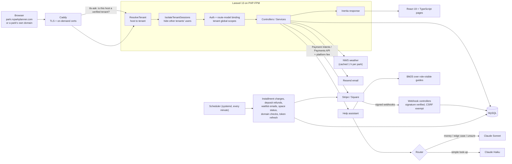

**How a request flows.** Caddy terminates TLS. Laravel's `ResolveTenant` middleware maps the host to a tenant: the central domain shows the marketing site, `{slug}.` hosts are looked up by slug, and any other host must be a verified custom domain. Tenant-owned models carry a global scope keyed to the current tenant. Controllers return Inertia responses, which the React pages render with typed props.

**Payments** are confirmed by provider webhooks: Stripe's signature is checked with `Webhook::constructEvent`, and Square's with HMAC-SHA256 compared via `hash_equals`. **Scheduled jobs** run every minute from a systemd timer. Jobs that move money use `withoutOverlapping()` so a slow run can never charge or refund twice.

---

## Engineering highlights

- **Tenant isolation that fails closed.** The tenant global scope on `Park` filters on `WHERE tenant_id = <current tenant>`. When no tenant is resolved (a console command, tinker or a seeder), that becomes `tenant_id IS NULL` and matches nothing, instead of returning every tenant's data. Code that genuinely needs cross-tenant access has to say so with `withoutGlobalScope('tenant')`.
- **Middleware ordering, done deliberately.** Laravel sorts route middleware by a framework-wide priority list, not by the order you register it. `ResolveTenant`, `RequireTenant`, `IsolateTenantSessions` and the session checks are anchored to the `AuthenticatesRequests` interface in a set registration order. This makes the tenant exist before route-model binding and before `auth` runs. I verified it by reflecting on the booted kernel's priority list.
- **Cross-site sign-in isolation.** Each park is fully separated: a signed-in user from one business is treated as a guest on every other business's site, covered by dedicated tenant-isolation and security-hardening test suites.
- **Signature-verified webhooks.** Stripe and Square webhooks are exempt from CSRF only because each one verifies the provider's signature. Square events are also checked against the tenant's own merchant ID.
- **Per-route rate limits with separate counters.** Every public or costly endpoint has its own throttle key (for example `throttle:5,1,rv-sites.book.prepare` or `throttle:30,1,help-assistant.staff`), so heavy use of one feature can't lock a user out of another. Rate-limited JSON requests get a plain-language message instead of a bare 429.
- **Time zones as a first-class concern.** "Today", booking dates, installment charge times, monthly fee statements and the hero banner all use each park's own time zone, and boundary tests check midnight in each park.
- **Testing approach.** The suite has 830 PHPUnit tests, organized as:
  - **Feature tests** for each area of the app.
  - **Scenario suites** that play out full guest and staff money flows: booking, amendments, deposits, refunds and installment payoffs.
  - **QA lifecycle suites** that use a Stripe fake to play out nightly stays, installment plans and reporting from start to finish.
  - **A security proof-of-concept suite.**
  - **A front-end/back-end pricing parity matrix.**

  The front-end banner maths is written as pure TypeScript and tested with `node --test`, and PHPUnit runs those Node tests too, so one command checks everything. Outbound HTTP is faked and stray requests are blocked.
- **AI cost control.** The router sends only questions that need care to the larger model. Every call is priced from token counts (including prompt-cache reads and writes) and logged, and the eval command lets me compare routing against Haiku-only and Sonnet-only runs before changing anything.
- **Zero-downtime deploys to a VPS I manage.** My own deploy script:
  1. Builds the assets and packs a release.
  2. Unpacks it into `releases/<timestamp>` next to a shared `.env` and `storage`.
  3. Runs `composer install`, migrations and `optimize`.
  4. Switches the `current` symlink in one atomic step (`ln -sfn` + `mv -T`) and reloads PHP-FPM.

  The last three releases are kept, so rollback is a single symlink flip.
- **Resilient external calls.** The NWS weather client runs only on the server, uses 3–4 second timeouts, caches each park's result for an hour, follows only links back to `api.weather.gov`, and shows clear skies if anything goes wrong.

---

## Screenshots and videos

| | |
|---|---|
| 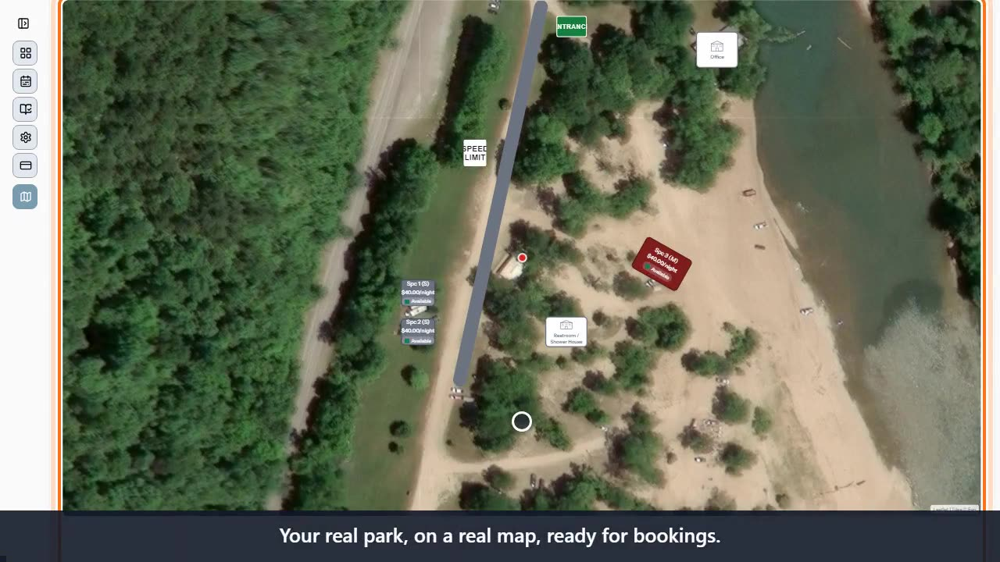 **Satellite map designer:** spaces, buildings, signs and a road placed on real imagery | 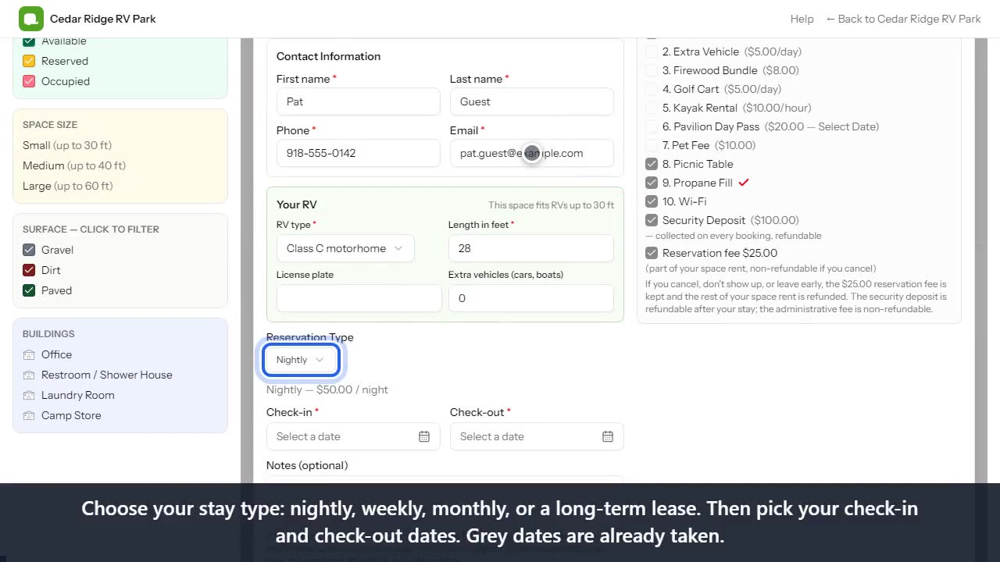 **Guest booking:** RV fit check, stay types, amenities and fees |
| 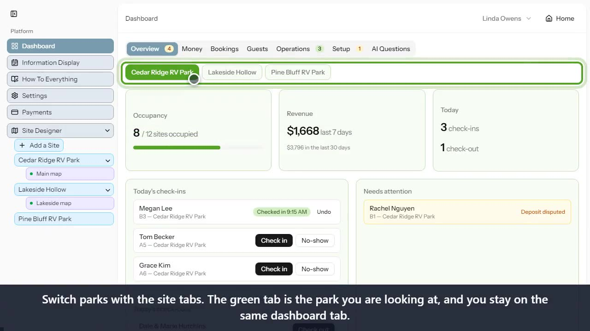 **Multi-park dashboard:** switch parks with the site tabs | 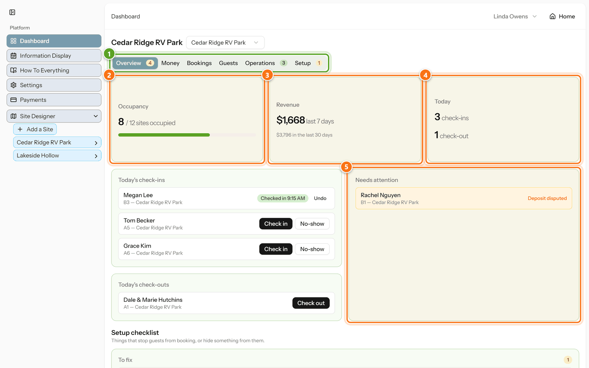 **Dashboard overview:** occupancy, revenue, arrivals and Needs Attention |
| 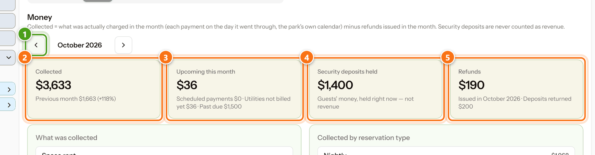 **Money tab:** collected, upcoming, deposits held and refunds | 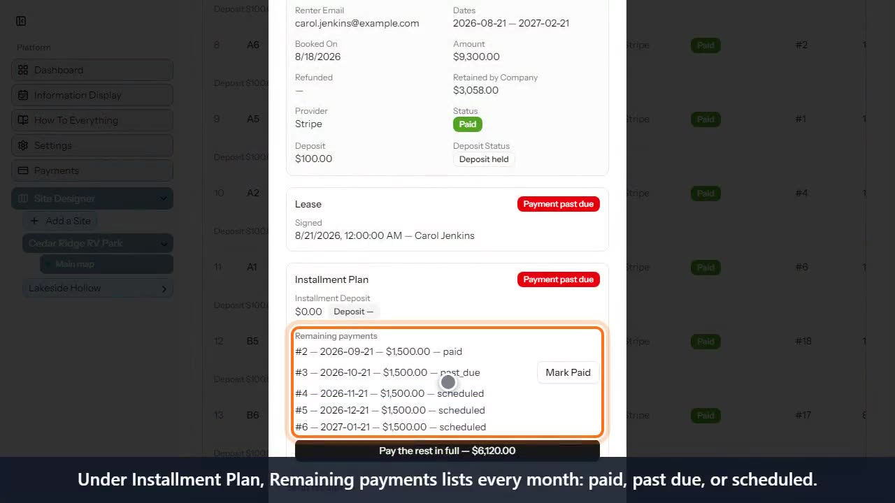 **Installment plan:** paid, past due and scheduled payments, plus "pay the rest" |
| 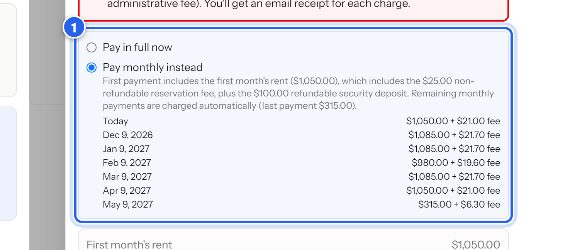 **Guest checkout:** every future monthly charge, shown up front | 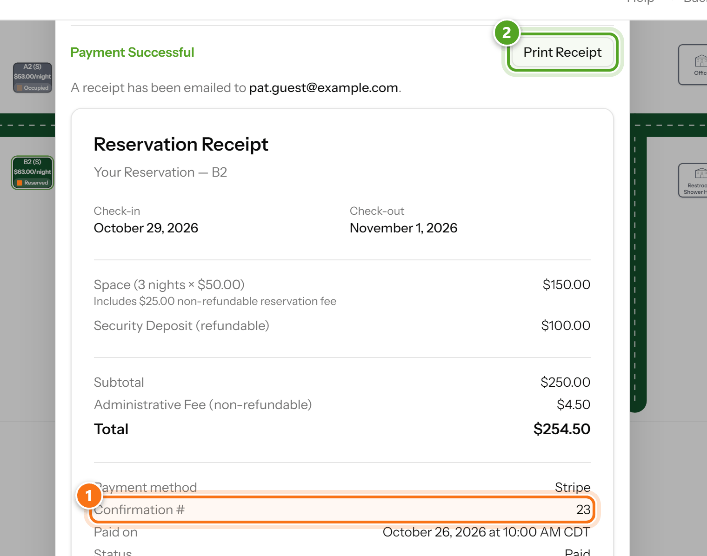 **Receipt:** confirmation number, fee breakdown and print/PDF |
| 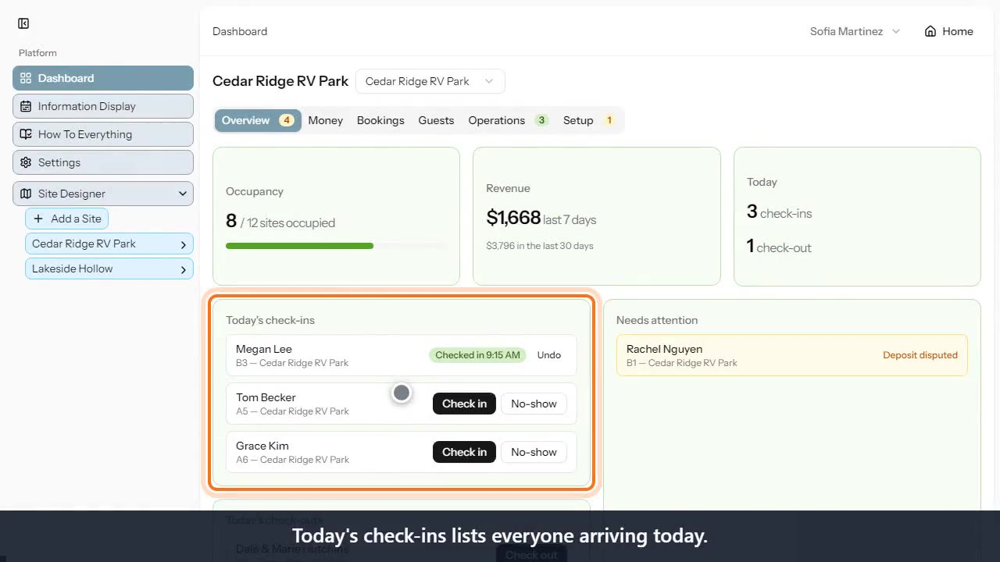 **Front desk:** check-in, no-show and undo | 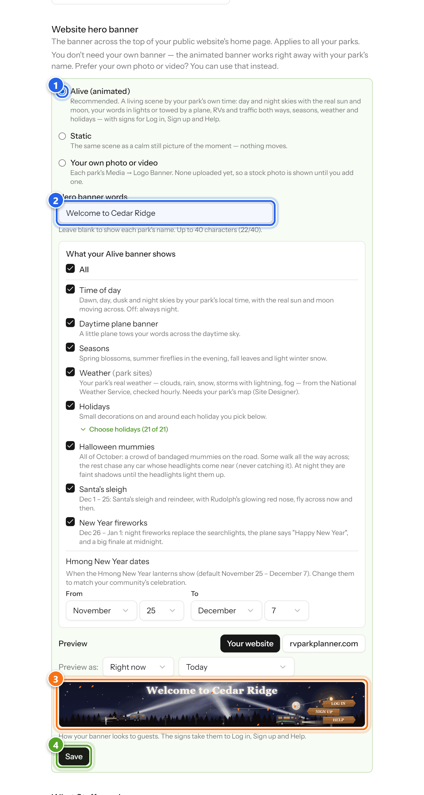 **Banner settings:** every part can be switched on or off and previewed |
| 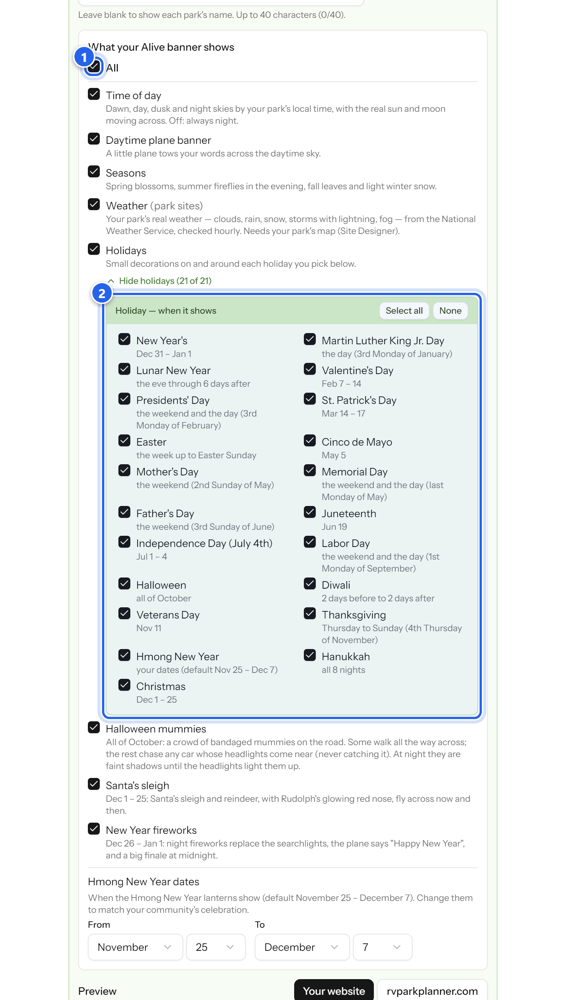 **21 holidays**, each with its own rule for when it shows | |

**Narrated demo videos** (recorded automatically by the how-to pipeline, with captions):

- [videos/staff-living-banner.mp4](videos/staff-living-banner.mp4): "A year in a minute", the living banner from sunrise to the New Year finale ([captions](videos/staff-living-banner.vtt))
- [videos/staff-map-designer.mp4](videos/staff-map-designer.mp4): designing a park on a satellite map ([captions](videos/staff-map-designer.vtt))

---

## Code samples

Selected files from the private repository, copied unchanged apart from a header comment. See [code-samples/README.md](code-samples/README.md).

| File | What it shows |
|---|---|
| [`hero-banner/hero-calendar.ts`](code-samples/hero-banner/hero-calendar.ts) | Pure TypeScript for dates in any time zone, holiday rules (Easter, nth weekday, lunar calendars), and real sun and moon positions |
| [`hero-banner/hero-walkers.ts`](code-samples/hero-banner/hero-walkers.ts) | Headlight-beam overlap, chase and wander steering, and leg timing so the feet don't slide |
| [`hero-banner/moon-phase.ts`](code-samples/hero-banner/moon-phase.ts) | A small, fully typed pure function for the moon's phase |
| [`hero-banner/*.test.mjs`](code-samples/hero-banner/) | 41 `node:test` tests. They run standalone with `node --test` (Node 22.18+) |
| [`laravel/ResolveTenant.php`](code-samples/laravel/ResolveTenant.php) | Finding the tenant from the host: subdomains, custom domains, 301s for renamed addresses, re-signing signed links |
| [`laravel/HeroWeather.php`](code-samples/laravel/HeroWeather.php) | A cached, fail-quiet National Weather Service client |

---

## About the code

The full source is private because RV Park Planner is a commercial product. I'm happy to walk through it in an interview, including the payment flows, the tenancy model, the AI routing and the test suites.

See [LICENSE-NOTICE.md](LICENSE-NOTICE.md). These files are shared for portfolio review only and are not open source.

## Contact

Yang Pao Thao, Full Stack Developer: [github.com/yangpaothao](https://github.com/yangpaothao)
